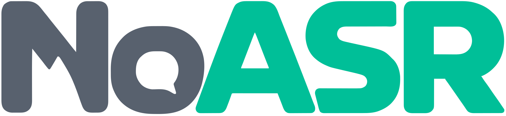

<p align="center">
  <picture>
    <source media="(prefers-color-scheme: dark)" srcset="docs/assets/readme-brand-dark.svg">
    <source media="(prefers-color-scheme: light)" srcset="docs/assets/readme-brand-light.svg">
    
  </picture>
</p>

# NoASR · Omni全模态语音输入法

市面上不缺一款新的语音输入法。NoASR 是我按自己的使用习惯做的一个小工具，采用 [MIT 协议](LICENSE)。想用就用，希望大家用得开心。

Omni 全模态驱动的语音输入法，一次完成转写、屏幕理解与文字整理。

用键盘或鼠标触发，把整理好的文字输入到当前输入框。屏幕上下文为可选功能，默认关闭。

## 说出来，接着做事

NoASR 把你说的话整理成文字，直接输入当前输入框。写消息、邮件，或给 AI 描述一段需求，都可以用它。

- **按住鼠标就能说**

  在输入框里长按鼠标左键开始录音，松开提交，不用再找键盘快捷键。习惯键盘的话，也支持长按说话和点按开关。

- **少做一点文字整理**

  自动补标点、分段，去掉口头禅和重复。你也可以修改提示词，让输出符合自己的表达习惯。

- **让模型多一点上下文**

  直接用 Omni 模型理解原始语音；需要时，还可以附带当前窗口截图，帮助理解你正在讨论的内容。截图功能默认关闭。

- **记住你常用的词**

  用个人词典保存人名、产品名和专业术语，也能从你的纠正中学习词条。

- **说过的内容，可以找回来**

  在本地历史里查看文字、回放录音，或换个模型重新识别。历史保存可以调整或关闭。

- **模型和服务，自己选**

  使用自己的 API Key，直接连接模型服务商，按用量付费。请求不经过作者服务器。

支持 macOS 和 Windows，两端的具体功能与操作略有不同。

识别需要网络，会把录音等请求内容发送给你配置的服务商。服务费用由该服务商按模型和用量收取；截图可能增加费用和等待时间，界面的费用为估算。应用不通过作者服务器转发请求。详见 [数据与隐私说明](PRIVACY.md)。

## 安装与使用

当前为**早期源码预览版**，主要提供源码与本地构建方式，尚未提供正式 Release 安装包。功能、界面和配置格式仍会调整，欢迎反馈问题和提交改进。

macOS 已在维护者的 Apple 芯片机器构建、自检并使用；Windows 配置、存储和密码框保护的逻辑回归已通过。跨机器、热键、录音、自动输入及管理员窗口等完整桌面流程仍需继续验证，详见 [预览版指南与已知限制](docs/PREVIEW_GUIDE.md)。

| 平台 | 环境与运行方式 | 详细说明 |
| --- | --- | --- |
| macOS | macOS 13+，提供本地开发构建；目前主要在 Apple 芯片机器验证 | [Mac 使用、开发构建与分发](macos/README.md) |
| Windows | Windows 桌面、Python / PySide6，当前从源码运行 | [Windows 使用与运行](windows/README.md) |

首次使用：到选定服务商的控制台创建 API Key，在“模型配置”选择服务商、填写 Key，并“测试连接”。确认模型已开通且账户有可用额度。自定义接口地址会收到你的 Key 和请求内容，请只填写可信地址。

Mac 默认使用右 Option，Windows 新配置默认使用左 Ctrl；都可以在“通用”里修改。先在自己的测试输入框中试用，再用于日常输入。

- 没有文字：检查麦克风、服务测试结果和系统权限；识别完成但未能输入时查看历史或剪贴板提示。
- 网络或模型错误：核对服务地区、接口地址、模型权限、Key 和余额；Gemini 使用系统代理。
- 快捷键冲突：换一个组合；Windows 目标程序以管理员身份运行时，NoASR 也需要相应权限。
- 关闭历史并不等于删除所有数据：词典和配置有各自的保存规则，见隐私说明。

## 开发与验证

Mac 无付费签名证书的本地开发入口：

```sh
./macos/build-dev.command
```

正式构建、安装与分发使用独立流程，不会因缺少证书自动回退到开发签名。两端分别在对应系统验证；自检与逻辑测试不能代替真实桌面、热键、录音或云端识别测试。

API Key、配置、历史和录音不要提交到仓库。上手方式、验证边界与已知限制见 [预览版指南](docs/PREVIEW_GUIDE.md)，协作说明见 [贡献指南](CONTRIBUTING.md)。

## 许可证

本项目自有代码、文档及随仓库提供的自有图标、字标和插图采用 [MIT 协议](LICENSE)。欢迎使用、修改、分享和商用，保留协议要求的版权与许可声明即可。

第三方组件遵循各自的许可证，见 [第三方说明](THIRD_PARTY.md)。项目阶段说明见 [源码预览说明](PREVIEW.md)。

## 🥚 还在折腾的一个小功能

每天用语音输入说了那么多话，如果拿来练英语呢？

我正在尝试把这些日常表达变成口语练习：从你真正想说的话出发，练习用英语表达。等做得顺手了，再放出来给大家用。
