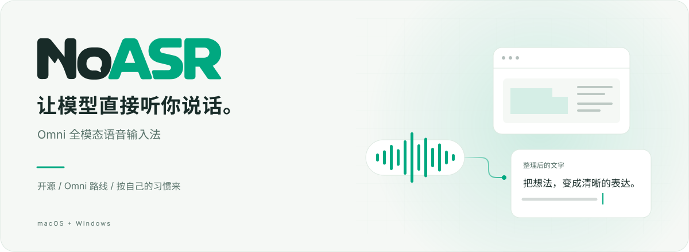

<p align="center">
  <picture>
    <source media="(prefers-color-scheme: dark)" srcset="docs/assets/readme-banner-dark.svg">
    <source media="(prefers-color-scheme: light)" srcset="docs/assets/readme-banner-light.svg">
    
  </picture>
</p>

# NoASR

**给爱折腾的人，一个可以自己改的语音输入法。**

我每天用语音写消息，也用它给 AI 讲需求。用得多了，总有些地方想按自己的习惯来：选哪个模型、怎么整理文字、用什么动作开始录音。

NoASR 就是这样做出来的。它走 Omni 全模态路线，把原始音频直接交给模型；模型、提示词、个人词典和唤起方式，都留给自己选择。源码放在这里，给同样有这些需求的人。

[为什么选 Omni](#omni) · [能折腾什么](#custom) · [安装与使用](#start) · [开发进度](#boundary)

<a id="omni"></a>

## 让模型直接听，少一道中间转写

很多 AI 语音输入工具会先用 ASR 把音频转成文字，再交给语言模型整理。NoASR 选择把原始音频直接发给 Omni 模型。

原因很简单：第一步听错的词、丢掉的停顿和语气，到了下一步，模型只能从文字里推测。我更愿意让负责理解和整理的模型直接拿到音频。

```text
原始音频 ＋ 可选的屏幕上下文
                ↓
            Omni 模型
                ↓
     转写、整理、排版后的文字
```

一次请求里处理音频、整理文字和排版；需要时，附带当前窗口截图，帮助模型理解你正在说的内容。屏幕上下文默认关闭。

这也意味着 NoASR 目前采用**录完再处理**的方式，暂不提供边说边上屏的实时转写。

> 强烈推荐体验一把全模态模型。我个人最常用的是火山的 Seed2.1 + Fast 模式。

<a id="custom"></a>

## 可定制的地方

### 模型和提示词，自己选

使用自己的 API Key 连接模型服务商。你可以换模型，也可以修改整理提示词：保留多少口语、怎么分段、专业词怎么写，都可以逐步调成自己顺手的样子。

### 经常说的词，自己维护

人名、项目名、代码里的术语，可以放进个人词典。应用也能从你的纠正中学习词条，减少反复修改同一个词。

### 说过的话，留在手边

在本地历史里查看结果、回放录音，或换一个模型重新识别。历史保存可以调整或关闭。需要更不一样的行为，就从源码继续改。

## 录音，也按你的节奏来

有时想按住说一句，有时需要腾出手继续操作。NoASR 提供长按、点按开关，以及鼠标左键长按等唤起方式。

按键和操作方式可以配置。macOS 与 Windows 独立实现，具体支持范围见两端说明。

## 数据与隐私

- **用自己的 Key。** 请求直接连接你配置的模型服务商，不经过作者服务器转发。
- **录音会发送给服务商。** 开启屏幕上下文后，所选截图也会随请求发送。NoASR 不是离线语音识别工具。
- **配置、词典和历史保存在本地。** 历史中的文字和录音可以按需管理；关闭历史不会一并删除其他数据。
- **服务费用自己承担。** 按服务商的计价规则结算，截图可能增加费用和等待时间。

请求内容的保存和使用由所选服务商的政策决定；自定义接口会收到 API Key 和请求内容。完整说明见 [PRIVACY.md](PRIVACY.md)。

<a id="start"></a>

## 安装与使用

提供 macOS 和 Windows 安装包，也可以直接从源码构建。

| 平台 | 安装包 |
| --- | --- |
| macOS 13+ · Apple 芯片 | [下载 DMG 安装盘](https://github.com/congxstudio/NoASR/releases/download/v0.1.0-preview.1/NoASR-0.1.0-preview.1.dmg)（已签名、公证） |
| Windows · x64 | [下载安装程序](https://github.com/congxstudio/NoASR/releases/download/v0.1.0-preview.1/NoASR-0.1.0-preview.1-windows-x64-setup.exe)（未签名预览版） |

[全部版本与 SHA256 校验文件](https://github.com/congxstudio/NoASR/releases)

安装后，在模型配置里选择服务商，填入自己的 API Key，测试连接。

<details>
<summary>从源码构建</summary>

macOS 的本地开发入口：

```sh
./macos/build-dev.command
```

Windows 使用 Python / PySide6，构建与运行步骤见平台说明。

[macOS 说明](macos/README.md) · [Windows 说明](windows/README.md) · [预览版指南](docs/PREVIEW_GUIDE.md)

</details>

<a id="boundary"></a>

## 目前的进度

功能、界面和配置格式都可能继续调整。macOS 已在维护者机器上构建、自检并使用；Windows 部分配置、存储和保护逻辑已有回归验证。

跨机器的热键、录音、自动输入，以及 Windows 管理员窗口等场景，还需要继续测试。

问题和改进可以提 Issue 或 PR，附上系统版本、模型和复现步骤即可。

## 开源出来，给有需要的人

NoASR 采用 [MIT 协议](LICENSE)。你可以使用、修改、分享，也可以按自己的想法继续做，保留协议要求的声明即可。第三方组件遵循各自的许可证。

我会继续按自己的使用习惯改，也欢迎一起折腾。

## 🥚 顺手再折腾一点

每天用语音说了这么多话，我还想试试：能不能把自己真正想说的话，变成英语口语练习？

还在做，等自己用顺手了再放出来。

第三方组件及许可证见 [THIRD_PARTY.md](THIRD_PARTY.md)。
